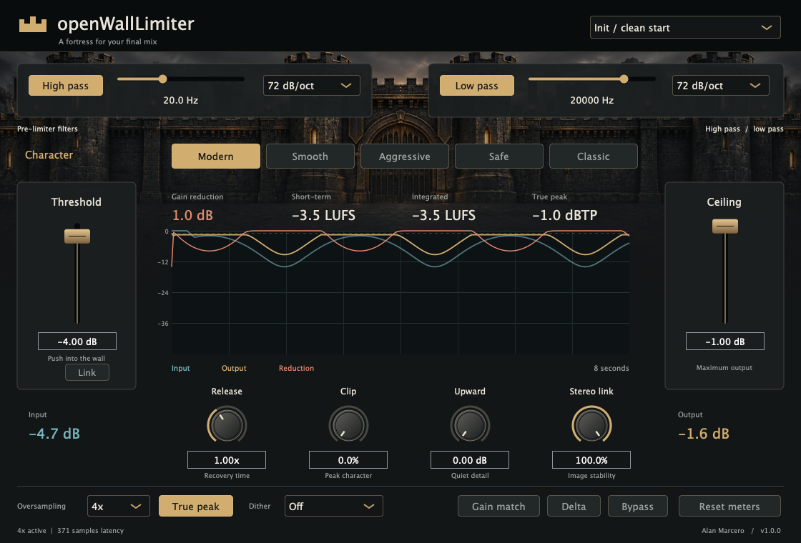

# openWallLimiter

A mastering limiter with five characters and a wall that holds. Selectable high/low-pass filters shape the signal before it reaches the limiter.



[Download VST3 / AU](https://github.com/alanmarcero/openWallLimiter/releases/latest) · [Install with OpenVST Manager](https://github.com/alanmarcero/alan-m-OpenVSTManager/releases/latest)

## Shape the final mix

1. Set the **High pass** and **Low pass** filters. Their ranges, slopes and defaults match [openMaster](https://github.com/alanmarcero/openMaster): 10–200 Hz and 8–24 kHz, with 12/24/48/72/96 dB/oct Butterworth slopes. Click either filter's button to bypass it. Filters run before input drive and limiting.
2. Lower **Threshold** to push the mix into limiting, and set **Ceiling** for the output peak level. **Link** moves the two faders together when dragging.
3. Choose **Modern**, **Smooth**, **Aggressive**, **Safe**, or **Classic**. Adjust **Release**, **Clip**, **Upward**, and **Stereo link** to taste.
4. Enable **True peak** to add post-downsampling reconstructed-peak protection. Choose oversampling up to 16x. True peak always uses at least 4x, even when the menu is set lower; the footer shows the active factor.
5. Compare with **Gain match** or audition what changed with **Delta**. Reset the loudness/peak measurement when starting a new pass.

Double-click a knob/fader to restore its default, or type a precise value. Parameters support DAW automation and session recall. The preset menu supplies starting points; sessions store the resulting parameters.

| Character | Behavior |
| --- | --- |
| Modern | Balanced and punchy. 2.5 ms attack and a program-dependent release: transients recover fast, sustained limiting recovers slowly. |
| Smooth | Transparent and relaxed. Full 5 ms attack and a rounded two-stage release. |
| Aggressive | Loud and forward. 1 ms attack, fast release and the most transient clipping. |
| Safe | Clean under heavy limiting. Full attack, long hold, slow release and no intentional clipping. |
| Classic | Steady and familiar. The release recovers at a constant 40 dB per second. |

**Upward** lifts quiet, audible material with a gate at very low levels. **Stereo link** blends independent channel detection toward shared gain reduction. The final true-peak guard is fully linked to preserve the stereo image. **Clip** lets transients clip instead of pulling the gain down. Sustained limiting shrinks the allowance, so held notes and bass stay clean. Clip has no effect in Safe mode.

The meter panel includes short-term and gated integrated LUFS, maximum estimated true peak, sample input/output peaks, gain reduction and an eight-second history. Short-term LUFS needs three seconds of audio. The gain-reduction readout describes the main limiter envelope, excluding clipping, upward gain and the final true-peak guard. Peak and loudness meters read the selected monitoring output.

## Formats and installation

- **macOS 11+**, Apple Silicon and Intel: universal VST3 and Audio Unit.
- **Windows 10+ x64**: VST3.

Download and open [OpenVST Manager](https://github.com/alanmarcero/alan-m-OpenVSTManager/releases/latest), refresh the catalog, select **openWallLimiter**, and install VST3 or AU (macOS only). Rescan plugins in your DAW after installation.

For manual installation, extract the release ZIP and copy `openWallLimiter.vst3` into your DAW's VST3 folder. On macOS the user folders are `~/Library/Audio/Plug-Ins/VST3` and `~/Library/Audio/Plug-Ins/Components`. Close the DAW before replacing bundles and rescan after installation. Windows' standard VST3 folder is `C:\Program Files\Common Files\VST3`.

macOS bundles are ad-hoc signed, not notarized. Verify downloaded files with `SHA256SUMS.txt`; macOS may require allowing the plugin in Privacy & Security. The manager handles installation to writable plugin folders.

## Processing notes

openWallLimiter uses original DSP and artwork. The algorithms and source research are documented in [ALGORITHMS.md](docs/ALGORITHMS.md).

The signal path is:

`high pass → low pass → oversampling → threshold drive/upward → lookahead limiter/clip → downsampling → true-peak guard → dither → monitoring`

The limiter delays audio by 5 ms. Each character's attack uses up to that lookahead. All oversampling paths are padded to one fixed reported latency, with another 128 samples for the final guard. Oversampling changes warm the new path and crossfade for 20 ms. CPU use rises temporarily during that transition. Buffers are allocated in preparation, outside the audio callback.

True-peak protection uses an eight-phase, 96-tap windowed-sinc detector **after** downsampling, followed by finite lookahead gain smoothing and a 0.3 dB reconstruction reserve. The main limiter limits to the same reserve, so the guard only removes reconstruction overshoot. Tests independently reconstruct output at 16 phases with 64 taps. Metering uses a separate 4x FIR estimate. These are practical finite-filter estimates, not a guarantee about every possible DAC/reconstruction filter or lossy encoder. Use suitable delivery headroom and check your final encoded master.

Gain match removes threshold makeup gain. Delta plays processed output minus the latency-aligned original; bypass plays that original. These audition paths can exceed the limiter ceiling. The dry reference includes the complete plugin latency and is taken before the filters. Floating-point processing is single precision with double-precision envelope/filter calculations. Supported host rates are 8–192 kHz, mono or stereo.

Dither is optional unshaped TPDF with 16- or 24-bit quantization. Leave it off when another tool handles final bit-depth conversion. This release has no LRA readout or noise shaping.

## Build and validate

Requires CMake 3.22+, a C++20 compiler, and platform development tools. CMake downloads JUCE 8.0.9.

```sh
cmake -S . -B build -DCMAKE_BUILD_TYPE=Release
cmake --build build --config Release --parallel
ctest --test-dir build -C Release --output-on-failure
```

On macOS add `-DCMAKE_OSX_ARCHITECTURES="arm64;x86_64" -DCMAKE_OSX_DEPLOYMENT_TARGET=11.0` for a universal build. Windows: configure with `-A x64`. A standalone development host is also built; release archives contain plugin bundles.

DSP-only tests need no JUCE or desktop:

```sh
cmake -S . -B build-core -DOWL_BUILD_PLUGIN=OFF -DCMAKE_BUILD_TYPE=Release
cmake --build build-core --parallel
ctest --test-dir build-core --output-on-failure
```

CI runs ASan/UBSan core tests, native host/control tests, pluginval strictness 5, macOS universal and Windows x64 builds, then publishes both ZIPs with checksums when a `v*` tag is pushed. The native tests save an actual editor screenshot.

AGPL-3.0. See [third-party credits](THIRD_PARTY.md) and [generated artwork prompt](assets/ARTWORK.md).
