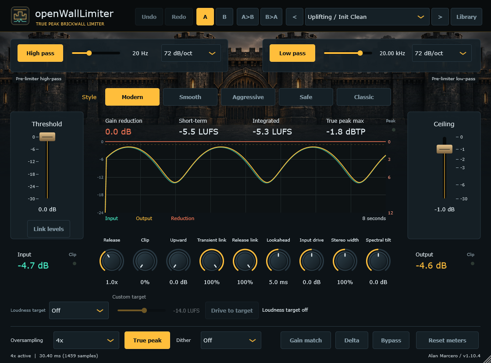

# openWallLimiter

A mastering limiter for controlling peaks and loudness at the end of a mix.

[Download the latest release](https://github.com/alanmarcero/openWallLimiter/releases/latest) · [Install with OpenVST Manager](https://github.com/alanmarcero/alan-m-OpenVSTManager/releases/latest)

## Beta

All of these plugins are in beta. The macOS and Linux builds are not up to date, so the Windows build is the one to use for now. A plugin can change dramatically from one release to the next, but the goal is for each one to keep getting better.

The fortress mark pulses on quarter notes from the DAW transport, including after tempo changes or seeks. It holds when playback stops. Hosts without transport use an audio-sample clock.

## Controls

- **High pass and Low pass:** Filter audio before limiting. High pass covers 10–200 Hz; Low pass covers 8–24 kHz. Choose 12, 24, 48, 72, or 96 dB-per-octave slopes, or bypass either filter.
- **Threshold and Ceiling:** Set limiting and maximum output level. Link the controls to move them together.
- **Style:** Choose Modern, Smooth, Aggressive, Safe, or Classic. 48 factory presets organized across seven dance genres (12 Uplifting plus 6 each in Rolling, Progressive, Psy, Tech, Bass & Breaks, and Classic) provide starting points. The host sees those 48 presets as programs.
- **Release, Clip, and Upward:** Set recovery time, allow transient clipping, and lift quiet audio.
- **Transient link and Release link:** Set how much the channels share peak detection and limiter recovery.
- **Lookahead:** Set transient anticipation from 0 to 10 ms. Reported host latency does not follow this control. It is the linear-phase sub-cut delay, the limiter delay (about 10 ms, rounded so the oversampling paths stay aligned), the longest oversampling filter delay, and the 128-sample true-peak guard. Changing lookahead, oversampling, or true peak does not change the reported latency. The editor shows that latency in milliseconds and samples.
- **Loudness target:** Choose Streaming (−14 LUFS), Club (−9 LUFS), or a custom target. The editor compares the BS.1770 reading with that target. Drive to target adds the difference to Input drive, within ±12 dB.
- **Undo and A/B:** Undo and Redo step through parameter edits (Cmd/Ctrl+Z, Shift+Cmd/Ctrl+Z). A and B keep two full setups. A>B and B>A copy one onto the other.
- **Library:** Save, rename, and delete your own presets in Documents/Alan Marcero/openWallLimiter/Presets. Search and favourite factory or saved presets there. Factory presets stay read-only.
- **Window:** Drag the corner to resize. The aspect ratio is not locked: the layout scales evenly and stays centred. The minimum keeps buttons readable, and the size is saved with the session.
- **True peak and Oversampling:** Enable True peak for protection against peaks between samples. Choose Off, 2x, 4x, 8x, or 16x oversampling. True peak uses at least 4x.
- **Meters:** View gain reduction on its own scale, short-term and integrated loudness, peak levels held for one second, true peak max, and an eight-second history. Meters read the limiter output, so Gain match, Delta, and Bypass change only what you hear. Input and Output keep a red dot after a peak above 0 dBFS. Click True peak max or a dot to clear it, or reset all measurements for a new pass.
- **Gain match and Delta:** Match levels for comparison or listen to the difference between processed and original audio.
- **Dither:** Choose Off, 24-bit, or 16-bit psychoacoustic noise-shaped TPDF dither.
- **Bypass:** Bypass the complete limiter.

Choose a style to set the limiter's response:

| Style | Character |
| --- | --- |
| Modern | Balanced, with fast recovery for transients. |
| Smooth | Transparent, with a slower attack and rounded recovery. |
| Aggressive | Fast recovery with more transient clipping. |
| Safe | Slow recovery without intentional clipping. The Clip control has no effect. |
| Classic | Steady recovery. |

Parameters support DAW automation and session recall. The limiter supports mono and stereo audio.

## Formats

- **macOS 11 or newer:** Universal VST3 and Audio Unit (AU).
- **Windows 10 or newer, x64:** VST3.

Use [OpenVST Manager](https://github.com/alanmarcero/alan-m-OpenVSTManager/releases/latest) or download a package from the [latest release](https://github.com/alanmarcero/openWallLimiter/releases/latest).

## License

MIT. See [LICENSE](LICENSE) and [third-party credits](THIRD_PARTY.md). JUCE remains under its own license.
