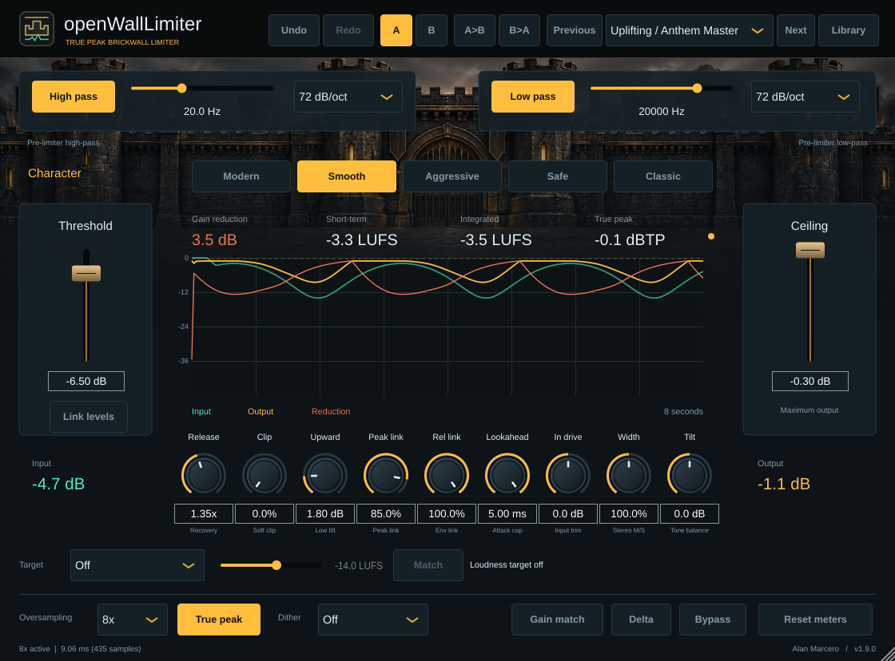
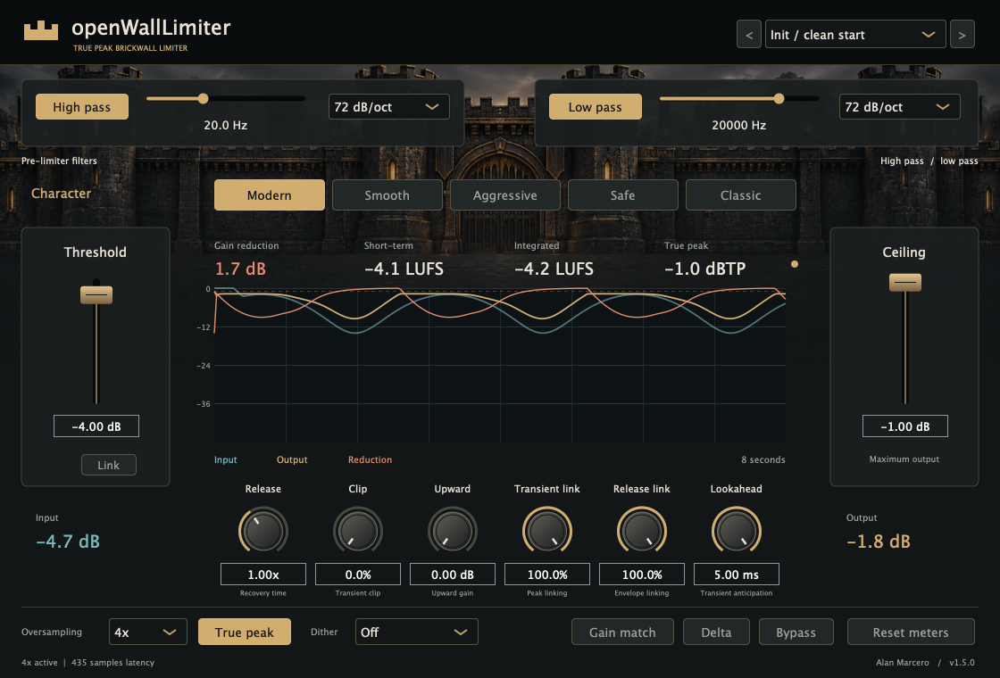

# openWallLimiter 1.9.0

The editor resizes without a locked aspect ratio and remembers its size. Latency shown to the host includes the oversampling filters and the 128-sample true-peak guard, and the editor prints that delay in milliseconds and samples. Streaming (−14 LUFS) and club (−9 LUFS) loudness targets sit on the BS.1770 meter. The 48 factory presets are host programs. Undo, A/B compare, and saved presets are in the editor. The project license is MIT.

# openWallLimiter 1.8.0

Organizes 48 factory presets across seven dance music styles (12 Uplifting plus 6 each in Rolling, Progressive, Psy, Tech, Bass & Breaks, and Classic) and updates the editor preset layout.

# openWallLimiter 1.7.1

Skips idle oversampling FIR passes when oversampling is inactive and repaints meters using dirty rects for lower CPU usage.

# openWallLimiter 1.7.0

Adds Pre-Limiter Input Drive, Stereo Width, and Spectral Tilt controls with standardized suite UI layout and an updated native editor screenshot.

# openWallLimiter 1.6.0

The new fortress emblem follows host quarter notes. Larger controls, a clearer Link levels switch and dark tooltips make the limiter easier to operate while watching the meters.

# openWallLimiter 1.5.1

- Updated the editor with the suite's graphite, mint, and amber palette.
- Enlarged controls and clarified preset navigation and button labels for easier use.
- Rebalanced the native editor and refreshed its screenshot.

# openWallLimiter 1.5.0

- Added adjustable 0–5 ms lookahead without changing the fixed host latency.
- Renamed Stereo Link to Transient Link while retaining its automation ID and behavior.
- Added independent Release Link control for stereo recovery envelopes.
- Older sessions load with 5 ms lookahead and independent release envelopes.
- Added slider, DSP, state migration, and native editor screenshot checks.

# openWallLimiter 1.1.4

Substantial sound quality improvements across all five limiter algorithms:

- **Eliminated sub-bass harmonic and intermodulation distortion**: Expanded minimum hold windows across all modes (18–26 ms) to fully bridge sub-bass half-cycles down to 25–30 Hz. THD at 30 Hz dropped from -27 dB (over 4% distortion in Aggressive) to -164.6 dB, and IMD at 40 Hz dropped from -31.9 dB to -145.1 dB.
- **Envelope corner rounding on all modes**: Enabled smooth one-pole release rounding across Modern, Aggressive, Classic, Smooth, and Safe modes, preventing gain-recovery slope kinks and spectral splatter.
- **Punchy and musical transient recovery**: Re-tuned attack and dual-stage release profiles (Modern: 2.2 ms attack, 40/260 ms release; Aggressive: 1.2 ms attack, 22/130 ms release; Classic: 1.8 ms attack, 30/240 ms opto-style release) for maximum punch and loudness without pumping.
- **Musical clip knee tuning**: Re-calibrated transient clipping allowance (1.0–2.5 dB) so soft-saturation only gently rounds peak crests without muddying the body of the mix.

# openWallLimiter 1.1.3

Wording only. Limiter behavior is unchanged.

- Mode tips state the attack, hold, release, and clip behavior. The panel no longer uses the fortress slogans. Ceiling still reads Maximum output.
- The README describes the limiter, the pre-limiter filters, and true-peak protection directly.

# openWallLimiter 1.1.2

A fix for lost treble at 44.1 kHz.

- With oversampling on at 44.1 kHz, the output lost treble even with no limiting: -2.4 dB at 10 kHz, -6.3 dB at 15 kHz and -10.9 dB at 18 kHz. The lookahead came to a half sample at the base rate, and the delay that aligns it averaged two samples. The lookahead now rounds up to a whole number of samples at every oversampling factor, and the response is flat. 48 kHz sessions were not affected.

Packages include macOS universal VST3/AU and Windows x64 VST3. macOS bundles are ad-hoc signed, not notarized.
